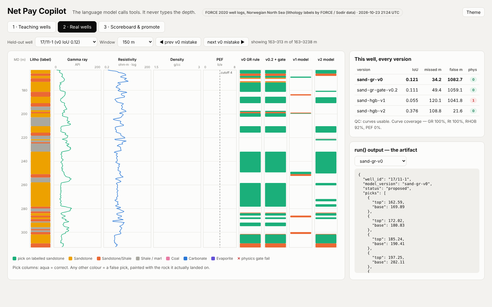
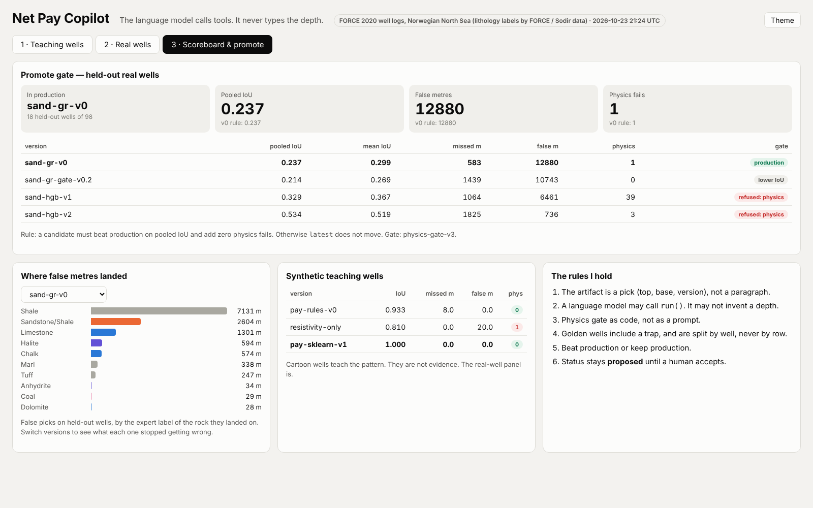

# Net Pay Copilot — evaluated ML on real North Sea well logs

A sandstone-interval picker built and tested on **98 real wells** from the FORCE 2020 dataset (Norwegian North Sea, expert lithology labels). It is scored the way an operator would score a tool: wells held out by **well**, never by row, physics checks written as code, and a release gate that refuses any model that is not clearly better.

The language model calls tools. It never types a depth.

## Results on 18 held-out wells

| Version | What it is | Pooled IoU | False metres | Release gate |
|---|---|---|---|---|
| Baseline | Gamma-ray rule (textbook) | 0.237 | 12,880 | in production |
| Rule + checks | Baseline plus density / PEF checks | 0.214 | 10,743 | lower accuracy |
| Model v1 | Gradient boosting, 6 log curves | 0.329 | 6,461 | refused |
| Model v2 | v1 plus geological context features | **0.534** | **736** | refused (see below) |

What the real data showed:

- **Better inputs beat a bigger model.** v1 → v2 was all feature design, not model size. False metres fell 17× against the baseline, and it trains in about a minute on a CPU.
- **Low gamma ray is not sand.** The baseline's false picks landed on shale, sandy shale, limestone, halite and chalk.
- **The textbook physics check was wrong.** About 30% of labelled sandstone failed a standard PEF check, likely because of barite in the drilling mud. Checks were recalibrated on training wells only.
- **Row splits lie.** The same model scores 0.53 on random rows but 0.34 on unseen wells: testing on rows makes it look about 1.6× better than it is.
- **The release gate refused the best model, and the gate was what needed fixing.** Its physics-fail count rewarded sloppy, oversized picks. Changing a metric after seeing the exam is not allowed, so the fix is tested on new wells first.

## How it works

1. Real logs split by well into training, validation and exam sets, so no well is seen twice.
2. A rule baseline, physics checks as code, then trained models, all scored on the same exam wells.
3. Every pick leaves the system as a proposal with its model version. A new model replaces production only if it beats it on the exam.

## Code

The source code is private. I'm happy to walk through it or share access with hiring teams on request: reach me on [LinkedIn](https://www.linkedin.com/in/abedamilola).

## Limits

- Labels are lithology interpretations, not ground truth, and sandstone is not the same as pay.
- One split of 18 exam wells. Results need repeating on other splits.
- Pooled IoU 0.53 makes this a proposal tool for human review, not an interpreter.

## Data credit

Well logs and lithology labels: FORCE 2020 Machine Learning Competition dataset (Bormann et al.), Norwegian North Sea; data originally from the Norwegian Offshore Directorate.

## Author

**Damilola Abe**, Subsea Engineer (M.S. Subsea Engineering, University of Houston). Also see [Subsea Multiverse](https://github.com/Dabe90/subsea-multiverse).
[LinkedIn](https://www.linkedin.com/in/abedamilola)
